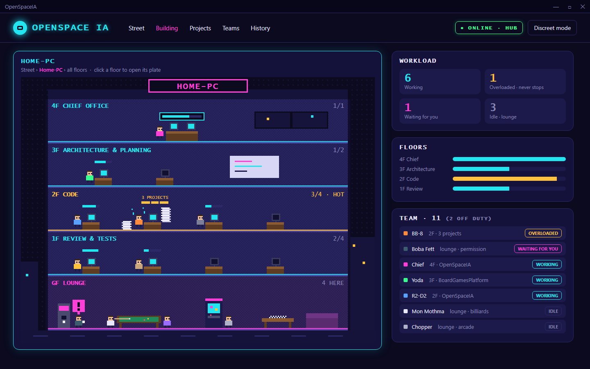
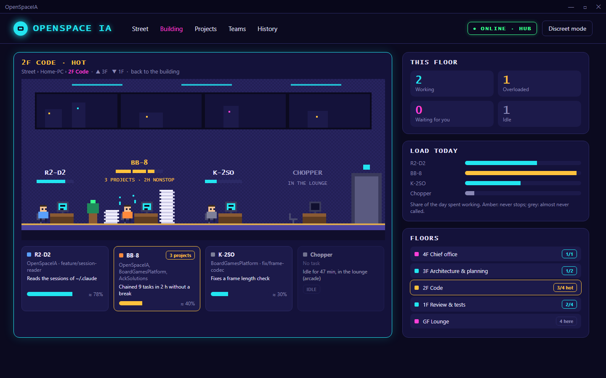
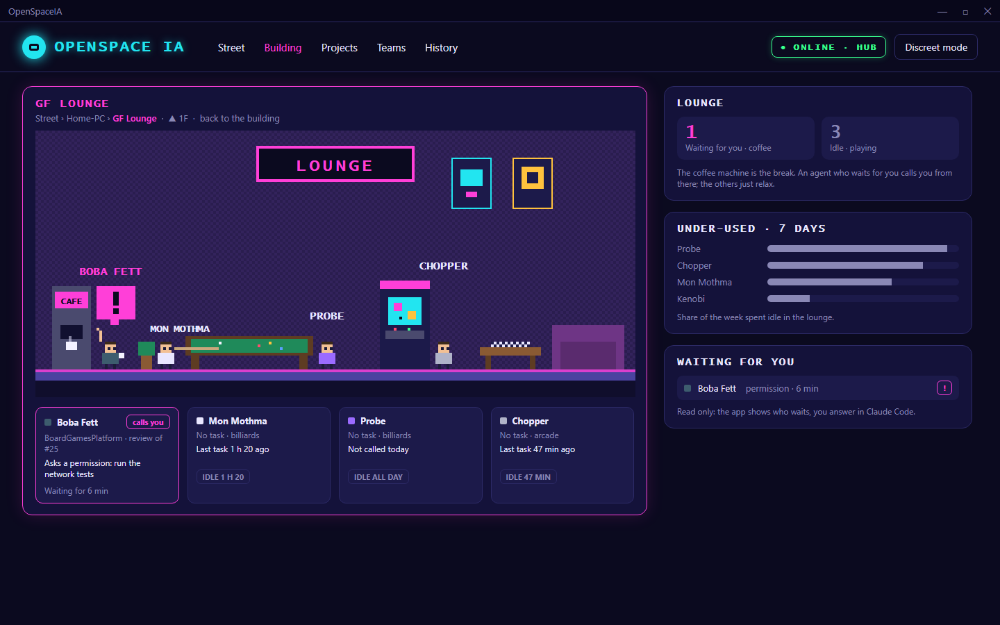

# OpenSpaceIA

<a href="#english">🇬🇧 English</a> | <a href="#français">🇫🇷 Français</a>

---

## English

An animated office, in the style of a SEGA Mega Drive game, that shows who works on what: Claude as project lead, its agents and sub-agents.
Its purpose is to see at a glance whether the agents are **overloaded** (they chain several projects and never stop) or **under-used** (they spend their time in the lounge).
Built on .NET 10 LTS, with a desktop application for Windows and Linux.

> **Status:** framing. The purpose, the architecture, the stack, the design and the roadmap ([doc/analyse/roadmap.md](doc/analyse/roadmap.md)) are defined. No code yet.

### Preview

Design mock-ups: they show the intended look, not the finished product.

The other screens (chief office, street, projects, teams, history) are in [doc/assets/mockups](doc/assets/mockups).

### How it works

| Part | Role |
|------|------|
| Collector | A service on each machine (a Windows service or a systemd user service). It reads `~/.claude` and sends the activity to the hub. |
| Hub | A SignalR server in the home lab (a Linux service or IIS). It gathers the machines and **only exposes reading**. |
| Desktop application | Avalonia, Windows and Linux. It shows the street (one building per machine), the floors and the agents. It is the **only** part that writes (creates agents and teams, assigns them to a project), and only on the machine where it runs. Without the hub, it reads `~/.claude` directly (local mode). |
| Web application | Later. Read only. |

### Requirements (planned)

| Tool     | Version                                       |
|----------|-----------------------------------------------|
| .NET SDK | 10.0 (LTS), pinned in `global.json`           |
| IDE      | Visual Studio 2026 (`.slnx` solution format)  |
| Doxygen  | Optional, to generate the API documentation   |

### Repository layout

| Path               | Purpose                                                       |
|--------------------|---------------------------------------------------------------|
| `src/`             | Source projects                                               |
| `test/`            | Test projects                                                 |
| `tools/`           | Reusable scripts (PowerShell, bash)                           |
| `doc/analyse/`     | Analysis: requirements, scope, architecture, decisions        |
| `doc/assets/`      | Images: design examples and mock-ups                          |
| `doc/dev/`         | Developer documentation (API reference generated by Doxygen)  |
| `doc/user/`        | User documentation                                            |
| `doc/adm/`         | Administrator documentation: installation, configuration      |

### Code quality (planned)

- Warnings are treated as errors: the build fails on any analyzer or style violation.
- Package versions are managed in one place.
- Tests with xUnit v3 on Microsoft.Testing.Platform, Shouldly, and ArchUnitNET for the architecture rules.
- Every member carries an XML documentation comment (`///`).

### Conventions

- Code, comments, documentation and commit messages are written in English. Only this README is also available in French.
- Commit messages follow [Conventional Commits](https://www.conventionalcommits.org) (`feat:`, `fix:`, `docs:`, `chore:`…).
- Branching model, pull requests, versioning and releases: see [CONTRIBUTING.md](CONTRIBUTING.md). Changes are listed in [CHANGELOG.md](CHANGELOG.md).

### License

Licensed under the [PolyForm Strict License 1.0.0](LICENSE).

In short: you may use the software for noncommercial purposes only. Distributing it, modifying it or creating derivative works is not permitted. For any other use, contact the author. The [LICENSE](LICENSE) file is the only legally binding text.

### Author

Michaël Defraene

---

## Français

Un bureau animé, dans le style d'un jeu Mega Drive de SEGA, qui montre qui travaille sur quoi : Claude en chef de projet, ses agents et ses sous-agents.
Son but est de voir d'un coup d'œil si les agents sont **surchargés** (ils enchaînent plusieurs projets sans jamais s'arrêter) ou **sous-employés** (ils passent leur temps au salon).
En .NET 10 LTS, avec une application de bureau pour Windows et Linux.

> **État :** cadrage. Le but, l'architecture, la stack, le design et la roadmap ([doc/analyse/roadmap.md](doc/analyse/roadmap.md), en anglais) sont définis. Pas encore de code.

### Aperçu

Maquettes de l'interface : elles montrent l'apparence visée, pas le produit fini.

Les autres écrans (bureau du chef, rue, projets, équipes, historique) sont dans [doc/assets/mockups](doc/assets/mockups).

### Fonctionnement

| Partie | Rôle |
|--------|------|
| Collecteur | Un service sur chaque machine (service Windows ou service utilisateur systemd). Il lit `~/.claude` et envoie l'activité au hub. |
| Hub | Un serveur SignalR dans le home lab (service Linux ou IIS). Il rassemble les machines et **n'expose que la lecture**. |
| Application de bureau | Avalonia, Windows et Linux. Elle montre la rue (un bâtiment par machine), les étages et les agents. C'est la **seule** partie qui écrit (créer des agents et des équipes, les assigner à un projet), et seulement sur la machine où elle tourne. Sans le hub, elle lit `~/.claude` directement (mode local). |
| Application web | Plus tard. Lecture seule. |

### Prérequis (prévus)

| Outil    | Version                                          |
|----------|--------------------------------------------------|
| SDK .NET | 10.0 (LTS), épinglé dans `global.json`           |
| IDE      | Visual Studio 2026 (format de solution `.slnx`)  |
| Doxygen  | Facultatif, pour générer la documentation de l'API |

### Organisation du dépôt

| Chemin             | Rôle                                                                |
|--------------------|---------------------------------------------------------------------|
| `src/`             | Projets sources                                                     |
| `test/`            | Projets de tests                                                    |
| `tools/`           | Scripts réutilisables (PowerShell, bash)                            |
| `doc/analyse/`     | Analyse : besoins, périmètre, architecture, décisions               |
| `doc/assets/`      | Images : exemples de design et maquettes                            |
| `doc/dev/`         | Documentation développeur (référence de l'API générée par Doxygen)  |
| `doc/user/`        | Documentation utilisateur                                           |
| `doc/adm/`         | Documentation administrateur : installation, configuration          |

### Qualité du code (prévue)

- Les avertissements sont traités comme des erreurs : toute violation d'un analyseur ou du style fait échouer la compilation.
- Les versions des paquets sont gérées à un seul endroit.
- Tests avec xUnit v3 sur Microsoft.Testing.Platform, Shouldly, et ArchUnitNET pour les règles d'architecture.
- Chaque membre porte un commentaire de documentation XML (`///`).

### Conventions

- Le code, les commentaires, la documentation et les messages de commit sont rédigés en anglais. Seul ce README existe aussi en français.
- Les messages de commit suivent [Conventional Commits](https://www.conventionalcommits.org/fr) (`feat:`, `fix:`, `docs:`, `chore:`…).
- Modèle de branches, pull requests, versions et releases : voir [CONTRIBUTING.md](CONTRIBUTING.md) (en anglais). Les changements sont listés dans [CHANGELOG.md](CHANGELOG.md).

### Licence

Distribué sous la [PolyForm Strict License 1.0.0](LICENSE).

En résumé : le logiciel peut être utilisé uniquement à des fins non commerciales. Sa distribution, sa modification et la création d'œuvres dérivées ne sont pas autorisées. Pour tout autre usage, contactez l'auteur. Seul le fichier [LICENSE](LICENSE), en anglais, fait foi.

### Auteur

Michaël Defraene
